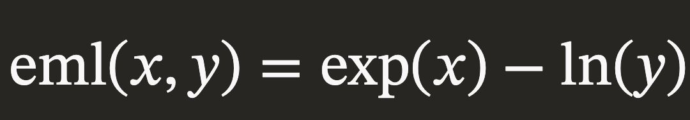
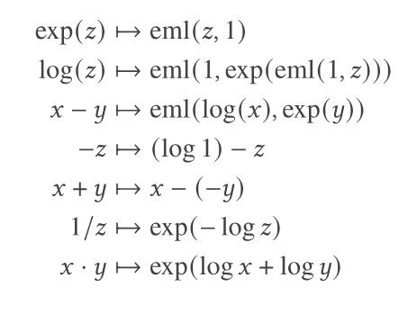
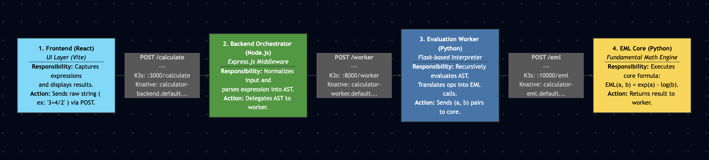
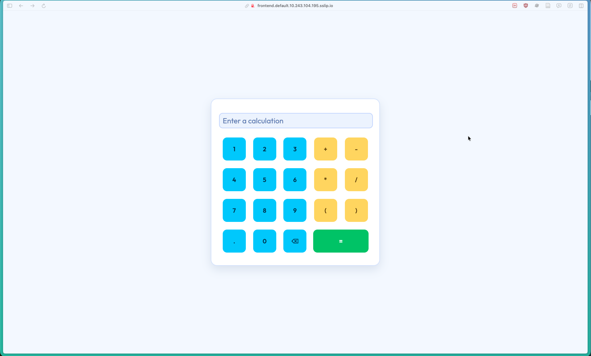
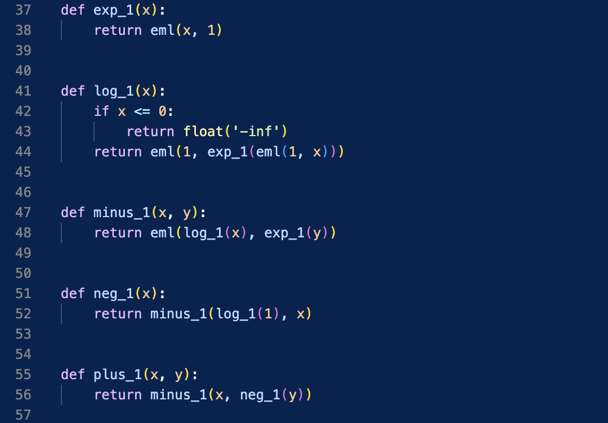

# Serverless Distributed Calculator

A cloud-native distributed system that demonstrates the power of serverless architecture and advanced mathematical abstraction. This project implements a full-stack calculator where all mathematical operations are derived from a single fundamental function, orchestrated across a multi-tier microservices environment using k.

## The EML Concept: Mathematical Abstraction

The core of this calculator is built on the **EML (Exponential-Minus-Logarithm)** concept. Instead of using standard arithmetic primitives, every operation (Addition, Subtraction, Multiplication, Division, Negation, etc.) is mathematically derived from a single core function:

$$EML(a, b) = e^a - \ln(b)$$

### Core Formula


### Derived Operations
By composing the EML function, we can generate the entire spectrum of arithmetic operations. Below are examples of how these functions are constructed:



---

## Architecture: Cloud-Native Microservices



The application is designed as a distributed system, leveraging **K3s** for lightweight Kubernetes orchestration or **Knative** for serverless scaling. The workload is divided into four specialized tiers:

### 1. Frontend (React)
A user interface built with **React** and **Vite**. It provides an intuitive calculator experience, sending arithmetic expressions such as "3+4/2" to the backend orchestrator via a REST API.



### 2. Backend Orchestrator (Node.js)
The brain of the system. Built with **Express**, it receives raw expressions, normalizes them, and parses them into an **Abstract Syntax Tree (AST)**. It then orchestrates the evaluation by delegating tasks (simple mathematical operations like +,-,*,/) to the Worker tier.

### 3. Worker Service (Python)
A specialized python **Flask** service that processes the AST. It traverses the tree and identifies the required mathematical operations (+,-,/,*) and the EML operations to execute.

 

Delegating the fundamental calculations to the EML service. A simple operation launches multiple EML calls (deliberately not optimal to display kubernetes capabilities).


### 4. EML Core Service (Python)
The high-performance core that implements the fundamental EML function. This service is designed to be highly scalable, handling the final mathematical execution of the simple EML function that powers the entire system.

---

## Project Structure

- **`Frontend/`**: React application and UI components.
- **`backend/`**: Contains the Node.js orchestrator (`calc/`), the Python evaluation worker (`worker/`), and the core EML service (`eml/`).
- **`k3s/`**: Kubernetes manifests (.yaml) and configurations for local and production-like clusters.
- **`knative/`**: Serverless service definitions and autoscaling configurations for Knative.
- **`automation/`**: Shell scripts for automated deployment via standard k3s or knative and environment setup on macOS and linux.
- **`documentation/`**: Detailed technical deep-dives into the architecture, mathematics, and deployment strategies.
- **`Ressources/`**: Visual assets and documentation diagrams used in this README.

---

## Setup & Configuration

This project is optimized for deployment on **standard Kubernetes (K3s)** or using **Knative** for serverless capabilities.

### Automated Deployment
The quickest way to get the system running is using the provided automation scripts:
```bash
# Deploy the entire stack to your K3s/Knative cluster
./automation/deploy.sh
```

### Manual Installation & Testing
For developers who wish to understand the deployment process in detail or run specific component tests, please refer to our comprehensive documentation:

- **Manual Deployment Guide**: See `documentation/knative/deploy-knative.md` for a step-by-step walkthrough.
- **Architecture Deep-Dive**: Explore `documentation/k3s/architecture-k3s.md` for cluster configuration details.
- **Testing**: Follow the instructions in `documentation/backend/backend.md` to run local tests for the orchestrator and workers.
